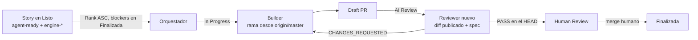

# Factoría agéntica Jira → PR (Claude · Cursor · OpenCode)

Este repo guarda los **contratos, agentes y workflows** de la factoría. Lo que hay aquí se copia a cada repo de producto. Aquí no hay código de producto: un humano diseña y aprueba las stories en Jira, y los agentes las implementan, se revisan y dejan un **Draft PR** para revisión humana.

> Estado: Claude v6.1 con routing estricto, Cursor v3 (builders en paralelo en worktrees) y OpenCode v3 (hasta 3 issues por run, en paralelo, Kimi K3.1 Pro + DeepSeek V4.1 Flash). Los detalles de cada provider están en [`multiprovider/README.md`](multiprovider/README.md).

## Índice

- [Cómo funciona](#cómo-funciona)
- [Providers](#providers)
- [Reglas comunes](#reglas-comunes-todos-los-providers)
- [Jira: funcionamiento e inyección de la tarea](#jira-cómo-funciona-y-cómo-llega-la-tarea-a-los-builders)
- [Estructura de este repo](#estructura-de-este-repo)
- [Guía de instalación](#guía-de-instalación-en-un-repo-de-producto)
  - [Claude](#1-claude-routine-diaria)
  - [Cursor](#2-cursor-automation-v3)
  - [OpenCode](#3-opencode-github-actions-v3)
- [Política de AGENTS.md](#política-de-agentsmd)
- [Troubleshooting](#troubleshooting)
- [Referencias](#referencias)

Próximas iniciativas (propuestas): [ROADMAP.md](ROADMAP.md).

## Cómo funciona

```text
Jira (Listo + agent-ready + engine-<provider>, blockers en Finalizada)
  └─► orquestador: selecciona por Rank ASC, comprueba dependencias y pasa la story a In Progress
        └─► builder(s): implementan en una rama nueva desde origin/master (fetch fresco)
              └─► Draft PR publicado
                    └─► reviewer independiente (contexto nuevo, solo lectura) sobre el diff publicado
                          ├─ CHANGES_REQUESTED → el mismo builder corrige en la misma rama y PR
                          └─ PASS en el HEAD actual → Jira pasa a Human Review
                                └─► el humano revisa, resuelve conflictos, hace merge y mueve a Finalizada
```

- **El humano** es el arquitecto, aprueba las features, resuelve los conflictos de Git y es el único que hace merge.
- **Jira** contiene el diseño aprobado, los criterios de aceptación, las dependencias, el Rank y el estado.
- **GitHub** contiene las ramas, los diffs, los tests y los PR reales.
- Ningún provider hace merge, despliega ni mueve stories a Done/Finalizada. Eso lo hace el humano después del merge.

## Providers

Cada story se asigna a **un solo** provider con una etiqueta de Jira: `engine-claude`, `engine-cursor` o `engine-opencode`. Si una story tiene cero etiquetas, o más de una, **todos** los providers la saltan. El detalle está en [`multiprovider/jira/ROUTING.md`](multiprovider/jira/ROUTING.md).

| | **Claude** | **Cursor** | **OpenCode** |
|---|---|---|---|
| Dónde corre | Claude Code Routine (nube) | Cursor Cloud Agent mediante **una** Automation programada | GitHub Actions (`ubuntu-latest`) |
| Orquestador | Opus (contrato en la Routine) | Modelo elegido en la Automation (contrato pegado en su prompt) | **Kimi K3.1 Pro**: `opencode-go/kimi-k3.1-pro`, `steps: 40` |
| Builder | Sonnet (`.claude/agents/feature-builder.md`) | `.cursor/agents/feature-builder.md` (`model: inherit`) | **DeepSeek V4.1 Flash**: `opencode-go/deepseek-v4.1-flash`, **sin límite de pasos** (no tiene clave `steps`) |
| Reviewer | Opus, solo lectura (`.claude/agents/pr-reviewer.md`) | `.cursor/agents/pr-reviewer.md` (`model: inherit`, `readonly: true`) | **Kimi K3.1 Pro**, `steps: 15`, comandos de solo lectura |
| Stories por run | Hasta 3 por Rank, en paralelo (worktrees) | Hasta 3 por Rank (`BATCH_LIMIT=3`), builders en paralelo en worktrees `/tmp/<KEY>-wt` que crea el orquestador | **Hasta 3** por Rank, en paralelo (matriz de jobs, `max-parallel: 3`, `fail-fast: false`); la selección es sin LLM |
| Disparo | Un único trigger *Schedule → Daily* en la UI de Claude Routines | Un único trigger *Schedule* diario en la Automation, escalonado respecto a Claude | `cron: '0 23 * * *'` (UTC), que son las 00:00 Europe/Madrid en invierno (CET), más `workflow_dispatch` manual |
| Rondas de corrección | Máximo 3 | Máximo 3, cada una con un reviewer nuevo | Máximo 1, y solo si se puede retomar el mismo builder y la misma rama |
| Rama | Worktree del builder | `cursor/<KEY>-<slug>` | `agent/<key-en-minúsculas>` |
| Límites | Cuota de la suscripción de Claude | Uso medido de Cloud Agents (requiere un plan con Cloud Agents y Automations) | Cuota de OpenCode Go por modelo. El watchdog para a los 900 s sin editar, a los 20400 s de total (5 h 40 min) o a los 5.000.000 de tokens de entrada informados. El job tiene un timeout de 355 min y un 429 lo para sin reintentar |

Notas:
- **Cursor v3 (opción B, en paralelo).** El orquestador hace `git fetch origin` y congela `BASE_COMMIT = origin/master`. Para cada story crea `git worktree add /tmp/<KEY>-wt -b cursor/<KEY>-<slug> <BASE_COMMIT>` y la verifica con `worktree list`, `show-toplevel`, la rama y `HEAD == BASE_COMMIT`. **Esa verificación es la prueba de aislamiento.** Lanza los builders a la vez y comprueba que el checkout padre sigue limpio (`git status --porcelain`). Para el reviewer, obtiene el diff con git autenticado (`git fetch origin pull/<N>/head`) y se lo pasa en un fichero `.review/pr-<N>-<HEAD>.diff`.
- **OpenCode v3.** El job `select` (sin LLM) hace el preflight de modelos y elige hasta 3 stories. `check_config.py` reintenta `opencode models opencode-go` hasta 3 veces, con 60 s entre intentos, y si bloquea nombra todos los modelos que faltan, sin sustituirlos. `jira_gate.py` valida la elegibilidad **sin gastar tokens**. El job `factory` es una matriz (`max-parallel: 3`, `fail-fast: false`): cada story tiene su runner, los mismos topes y un `opencode run` vigilado por `guarded_run.py`. `postflight.py` comprueba que existen el Draft PR, el marcador de review en el HEAD y Jira en Human Review. Si un job falla, el diff del builder se guarda como artefacto `opencode-factory-diff-<KEY>` (`.patch`, 7 días) sin hacer push; las otras stories siguen.
- **Cron de OpenCode y horario de verano.** GitHub Actions interpreta el cron en UTC. En verano (CEST), las 00:00 de Madrid serían `'0 22 * * *'`. No añadas un segundo schedule que se solape con las ventanas de Claude o Cursor.

## Reglas comunes (todos los providers)

- **Equivalencia de estados del tablero KAN:** **Ready = Listo** y **Done = Finalizada** (In Progress = En curso). Cualquier otro nombre no cuenta como Ready ni como Done.
- **Elegible** = Listo + `agent-ready` + **exactamente una** etiqueta `engine-*`, la del provider + diseño técnico y criterios de aceptación aprobados + ninguna rama ni PR abierta para esa key.
- **Puerta de dependencias (falla en cerrado).** Cada blocker real (`is blocked by` / `depends on`) tiene que estar **en Finalizada/Done ahora mismo**. No sirven Human Review, Resolved, `statusCategory = Done` ni un PR mergeado. Si faltan datos, la story se salta. Una issue que la candidata *bloquea* no es un prerequisito. Las stories saltadas se quedan en Listo.
- **Ramas:** siempre desde `origin/master` justo después de un `git fetch` fresco. Nunca desde un `master` local antiguo ni desde otra rama de feature.
- **PRs:** siempre en **Draft**. Jira solo pasa a **Human Review** con un PASS del reviewer independiente en el HEAD actual del PR.
- **Configuración cero en OpenCode:** no hay variables nuevas obligatorias ni `issue_key` obligatorio, y las stories no se tocan. Si una story no declara `Repository:`, `Repositorio:` o `Repositorio destino:`, se usa el repo del propio workflow, y una story que nombre otro repo se rechaza. El proyecto Jira por defecto es **`KAN`**. Cursor deduce `owner/repo` del entorno de la Automation. Claude exige que el repo de la story coincida con el de la Routine.
- **Una sola ejecución por provider y repo.** El estado de Jira no es un lock atómico, así que los horarios deben ser distintos y no solaparse.

## Jira: cómo funciona y cómo llega la tarea a los builders

Jira es la **fuente de verdad** de la factoría. Ahí está la especificación aprobada, los criterios de aceptación, las dependencias, el repo destino, el Rank, el provider asignado y el estado. Todo sale de los contratos ([Claude](multiprovider/claude/01-jira-three-parallel-STRICT-ROUTING.md), [Cursor](multiprovider/cursor/01-scheduled-implement.md), [portable](multiprovider/contracts/PORTABLE-CONTRACT.md)) y, en OpenCode, de [`jira_gate.py`](multiprovider/opencode/automation/opencode/jira_gate.py), [`guarded_run.py`](multiprovider/opencode/automation/opencode/guarded_run.py) y [`pilot-prompt.md`](multiprovider/opencode/automation/opencode/pilot-prompt.md).



### Qué se lee de cada story

| Dato | Dónde va | Quién lo usa |
|---|---|---|
| **Proyecto** | `KAN` (en OpenCode: `JIRA_PROJECT_KEY`; si no existe, el prefijo de la key; si tampoco, `KAN`) | Todos |
| **Resumen** (`summary`) | Título | Todos. OpenCode lo reduce a 120 caracteres en el resultado del gate |
| **Descripción** | Diseño técnico y funcional aprobado, **criterios de aceptación** y pruebas. No hay un campo propio para los criterios: van en la descripción | Todos. El gate de OpenCode **rechaza** descripciones de menos de 60 caracteres |
| **Repositorio** | Línea `Repository: owner/repo` (OpenCode también acepta `Repositorio:` y `Repositorio destino:`) o un campo propio (`JIRA_REPOSITORY_FIELD_ID`) | OpenCode: si falta, usa el repo del workflow, y si nombra otro repo, la story se rechaza. Cursor: tiene que coincidir con el `owner/repo` de la Automation. Claude: la coincidencia del repo es obligatoria |
| **Dependencias** | *Linked issues* `is blocked by` / `depends on`, una sección `Dependencies:` / `Dependencias:` en la descripción, frases como «blocked by», «depende de» o «bloqueado por», o un campo propio (`JIRA_DEPENDENCIES_FIELD_ID`) | Todos usan la unión de todas las fuentes. La dirección del enlace importa: lo que la story *bloquea* no es un prerequisito. Si el sentido es ambiguo, la story se salta |
| **Routing (etiquetas)** | `agent-ready` + **una sola** de `engine-claude`, `engine-cursor` o `engine-opencode` | Cada provider solo coge la suya. Si hay cero o varias etiquetas engine, la saltan todos |
| **Estado** | `status.name` | Solo cuenta Listo/Ready para elegir y Finalizada/Done para los blockers |

### Estados y quién los mueve

| Estado | Quién lo pone | Cuándo |
|---|---|---|
| **Listo** (Ready) | Humano | La story está diseñada, aprobada y etiquetada |
| **In Progress** (En curso) | Orquestador | Después de volver a comprobar estado, etiquetas, repo y blockers, y antes de lanzar el builder. Comprueba que la transición se ha aplicado |
| **AI Review** | Orquestador | Claude: justo antes de lanzar el reviewer. Cursor y OpenCode: cuando el Draft PR ya existe de verdad |
| **Human Review** | Orquestador | Solo con un PASS del reviewer en el HEAD actual del PR y los tests en verde. OpenCode publica antes un comentario con los marcadores de review en el PR |
| **Blocked** | Orquestador | Fallos: rondas de corrección agotadas, workspace perdido o review imposible. Cursor y OpenCode también pueden dejar la story en AI Review con el motivo |
| **Finalizada** (Done) | **Humano** | Después del merge. Ningún agente la pone |

- Las stories que se saltan (por blockers pendientes, otro engine u otro repo) **se quedan en Listo**. No se mueven a Blocked ni se llenan de comentarios.
- **Los agentes no cambian el contenido de las stories.** Los contratos solo les permiten leer, hacer transiciones y comentar. Cursor prohíbe tocar la arquitectura aprobada y reasignar issues. En OpenCode, el MCP Atlassian solo expone `jira_search`, `jira_get_issue`, `jira_get_transitions`, `jira_transition_issue` y `jira_add_comment`. Esa lista filtra herramientas pero **no es una barrera de permisos**, así que la cuenta de Jira debe tener los permisos mínimos.
- El gate de OpenCode (`jira_gate.py`) es de **solo lectura**: nunca mueve estados. Si la story no está en Listo/Ready, falla.

### Selección

- **Claude y Cursor:** el orquestador busca por MCP las stories en Listo + `agent-ready` ordenadas por `Rank ASC`. Lee el **detalle completo** de cada una (la JQL solo sirve como primer filtro) y toma las **3 primeras elegibles** (`BATCH_LIMIT=3`), siguiendo hacia abajo si se salta alguna. Comprueba los blockers dos veces: al elegir y justo antes de pasar a In Progress.
- **OpenCode:** si `issue_key` está vacío, el **job `select` sin LLM** elige **hasta 3** stories (`max_issues` 1–3, por defecto 3). Lanza por REST la JQL `project = "KAN" AND labels = "agent-ready" AND labels = "engine-opencode" AND statusCategory != Done ORDER BY Rank ASC`, sin filtrar el estado en la JQL, y valida candidata a candidata leyendo `summary`, `status`, `labels`, `description` e `issuelinks` (más los campos propios, si los hay). Se queda con las que pasan, por Rank, siempre que estén en Listo/Ready, lleven solo `engine-opencode`, tengan los blockers en Finalizada/Done y no exista ya la rama `agent/<key>` ni un PR abierto. Con `issue_key` solo entra esa story. Si ninguna pasa, el resultado es `NO_WORK` y el run acaba en verde. El job `factory` recomprueba esa story y el orquestador vuelve a comprobarlo todo por MCP.

### Inyección: qué recibe cada agente

| | **Claude** | **Cursor** | **OpenCode** |
|---|---|---|---|
| Cómo lee Jira el orquestador | Jira/Atlassian MCP de la Routine | Jira MCP del entorno del Cloud Agent | El runner, por REST (`jira_gate.py`). El orquestador Kimi, por MCP `mcp-atlassian` |
| Prompt del orquestador | El contrato pegado en la Routine | El contrato pegado en la Automation | `pilot-prompt.md`, donde `guarded_run.py` sustituye `__ISSUE_KEY__` y `__GITHUB_REPOSITORY__`, más el contrato `factory-orchestrator.md` |
| **Brief al builder** | Key + URL de Jira, spec aprobada **congelada** y completa, criterios de aceptación, `owner/repo`, rama base, commit base y registro `DEPENDENCY_GATE` (`VERIFIED_ALL_DONE` / `VERIFIED_NO_BLOCKERS`). Sin ese registro, el builder devuelve BLOCKED | Spec completa + URL, criterios, repo, `BASE_COMMIT`, rama `cursor/<KEY>-<slug>`, **ruta absoluta del worktree** `/tmp/<KEY>-wt` y las instrucciones aplicables (AGENTS.md) | Key, spec aprobada relevante, criterios, rama `agent/<key>` (creada por el runner desde `origin/master`) y ubicación de los AGENTS.md. La orden es buscar acotado y editar en 10 pasos o menos |
| Aislamiento del builder | Worktree propio (`isolation: worktree`) | Worktree creado y verificado por el orquestador | Checkout del runner en la rama de la story (hasta 3 jobs en paralelo, uno por story) |
| **Lo que recibe el reviewer** | El diff real del PR publicado, la spec de Jira y las convenciones del repo, incluidos los cambios en AGENTS.md | URL y número del PR, `BASE_COMMIT`, `HEAD_COMMIT`, **fichero `.review/pr-<N>-<HEAD>.diff`** obtenido con git autenticado, la ruta del worktree, el diseño original, la evidencia de tests y CI, y los cambios en AGENTS.md | Spec + URL de la issue y URL y HEAD del PR publicado. Lee el diff con `gh pr diff` / `gh pr view` y Jira con `jira_get_issue` / `jira_search`, todo en solo lectura |
| **Lo que vuelve a GitHub y a Jira** | Draft PR con la URL de Jira, el mapeo de criterios, los tests, AGENTS.md y los riesgos. Informe factual en Jira y transición a Human Review | Draft PR con `Factory Engine: cursor` y `Factory Jira: <KEY>`, la URL de Jira, el mapeo de criterios y los tests. Informe en Jira (key, repo, rama, PR, tests, veredicto y HEAD, AGENTS.md, rondas) y transición | Draft PR con `Factory Engine: opencode` y `Factory Jira: <KEY>`. Al pasar a AI Review se apuntan el enlace y el HEAD. Comentario en el PR con `Factory Review: PASS` / `Factory Review Head: <sha>` / `Factory Reviewer: pr-reviewer` y paso a Human Review. `postflight.py` comprueba el PR, el marcador y el estado |

### Ejemplo de story bien formada

Etiquetas: `agent-ready`, `engine-opencode` (o `engine-claude` / `engine-cursor`). Estado: **Listo**. Si depende de otra story, añade también el enlace *is blocked by* en *Linked issues*. La plantilla sigue la de [`multiprovider/jira/ROUTING.md`](multiprovider/jira/ROUTING.md); la tarea es solo un ejemplo.

```text
Resumen: Añadir el campo «Código» como fallback del identificador de licitación

Repository: alvaroarg/LicitacionesScrapping
Dependencies: None            (o: KAN-12, KAN-13)
Design approved: Yes (by human)

Technical design:
- Módulo/función afectados, qué cambia y qué no (sin decisiones abiertas).
- Contratos de datos o interfaces afectadas.

Acceptance criteria:
- Dado X, cuando Y, entonces Z (verificable).
- ...

Testing:
- Tests que hay que añadir o ajustar y comando para ejecutarlos (ver AGENTS.md).
```

Consejos: escribe nombres concretos de módulos y funciones (el builder de OpenCode busca con `rg` a partir de ellos), deja la descripción sin ambigüedades del tipo «pendiente» sin una key, y no pongas dos etiquetas `engine-*`.

## Estructura de este repo

```text
README.md                     # este documento (no se copia a los repos de producto)
AGENTS.md                     # plantilla: cada repo de producto rellena el suyo
.claude/agents/               # Claude v6: feature-builder (Sonnet) + pr-reviewer (Opus)
routines/01-jira-three-parallel.md          # prompt de Routine Claude v6 (sin routing)
reference/                    # contrato Opus y ejemplos de la puerta de dependencias
automation/prompts/           # contratos Opus y auditoría diaria
multiprovider/
  README.md                   # visión general multi-provider y orden de activación
  jira/ROUTING.md             # etiquetas engine-* y JQL de ejemplo
  contracts/PORTABLE-CONTRACT.md
  claude/01-jira-three-parallel-STRICT-ROUTING.md   # prompt Claude con routing estricto
  cursor/
    .cursor/agents/feature-builder.md
    .cursor/agents/pr-reviewer.md
    01-scheduled-implement.md # contrato del orquestador (se pega en la Automation)
    02-migration-old-reviewer.md, 02-pr-review.md (v1, superado), TEST-MATRIX.md
  opencode/                   # refleja la raíz de un repo de producto
    opencode.json
    .opencode/agents/{factory-orchestrator,feature-builder,pr-reviewer}.md
    .github/workflows/opencode-factory.yml        # v3 (el que se instala)
    .github/workflows/opencode-connectivity.yml   # solo diagnóstico manual
    .github/workflows/opencode-factory-PILOT.yml  # SUPERADO por el v3; no instalar los dos
    automation/opencode/{check_config,jira_gate,guarded_run,postflight}.py, pilot-prompt.md
    tests/                    # pruebas unitarias (python -m pytest -q tests)
    V3-README.md, MIGRACION.md, PRUEBAS-Y-ARRANQUE-LIMPIO.md, SETUP-AND-LIMITATIONS.md
```

## Guía de instalación en un repo de producto

Al repo de producto se copian los archivos del provider **con sus mismas rutas**. Se copia todo menos este README. No se borra ni se sustituye el `AGENTS.md` del repo (es propio de cada repo; si no tienes uno, usa como plantilla el [`AGENTS.md`](AGENTS.md) de aquí). Tampoco se tocan los agentes de los otros providers.

### 0. Jira (una vez, común a todos)

1. En el proyecto **KAN**, cada story lista lleva `agent-ready` y **una** etiqueta `engine-claude`, `engine-cursor` o `engine-opencode`.
2. Las dependencias van en *Linked issues → is blocked by / depends on*.
3. Plantilla de la story y JQL de ejemplo: [`multiprovider/jira/ROUTING.md`](multiprovider/jira/ROUTING.md).
4. Las transiciones In Progress, AI Review, Human Review y Blocked tienen que existir para el orquestador. Finalizada la pone el humano después del merge.

### 1. Claude (Routine diaria)

1. Copia `.claude/agents/feature-builder.md` y `.claude/agents/pr-reviewer.md` al repo, en la misma ruta, y haz commit y push.
2. En https://claude.ai/code/routines **edita la Routine que ya existe** (no crees otra) y pega **entero** `multiprovider/claude/01-jira-three-parallel-STRICT-ROUTING.md` en *Instructions*.
3. Deja Opus como modelo principal, el repo y los conectores de Jira y GitHub. Comprueba que la Routine puede leer los issue links y su estado.
4. Configura **un solo** trigger *Schedule → Daily* y quita los demás. Si quieres exactamente un run al día, no uses *Run now* el mismo día.

### 2. Cursor (Automation v3)

1. **Plan:** comprueba que tu plan de Cursor incluye Cloud Agents y Automations.
2. Copia `multiprovider/cursor/.cursor/agents/feature-builder.md` y `pr-reviewer.md` a `.cursor/agents/` del repo de producto. También puedes copiar `multiprovider/contracts/PORTABLE-CONTRACT.md` a `contracts/`. Haz commit y push a la rama por defecto. **No** instales un agente orquestador en el repo.
3. Prepara un entorno de Cloud Agent para **ese** repo con:
   - Jira MCP con búsqueda, detalle completo, issue links, transiciones y comentarios.
   - GitHub con lectura de diffs, push de ramas y creación de Draft PR. Nunca le des permiso de merge ni de deploy.
   - Tests que funcionen en la nube.
4. Crea **una** Automation `Factory | Cursor | <owner/repo> | daily`:
   - Trigger *Schedule* una vez al día, escalonado respecto a Claude.
   - Un modelo compatible con subagentes.
   - **Pega en el prompt el contrato del orquestador**: la sección «Main orchestrator contract» de [`multiprovider/cursor/01-scheduled-implement.md`](multiprovider/cursor/01-scheduled-implement.md). Va el texto, no un enlace.
   - **Cada vez que cambie ese archivo, vuelve a pegarlo.**
5. Desactiva o borra la Automation v1 *Draft PR opened* del reviewer, porque competiría con este run. Lo explica [`02-migration-old-reviewer.md`](multiprovider/cursor/02-migration-old-reviewer.md).
6. Haz una prueba manual con **una** story `engine-cursor` y sigue [`TEST-MATRIX.md`](multiprovider/cursor/TEST-MATRIX.md). En el log tienen que aparecer las verificaciones de cada worktree, el checkout padre limpio y `CONCURRENCY: PARALLEL` con el número real de stories.

### 3. OpenCode (GitHub Actions, v3)

1. Desde `multiprovider/opencode/`, copia a la raíz del repo de producto:
   ```text
   opencode.json                              # si ya tienes uno, FUSIONA default_agent, model, provider y mcp.jira
   .opencode/agents/factory-orchestrator.md
   .opencode/agents/feature-builder.md
   .opencode/agents/pr-reviewer.md
   .github/workflows/opencode-factory.yml     # solo este workflow de implementación
   automation/opencode/check_config.py
   automation/opencode/jira_gate.py
   automation/opencode/guarded_run.py
   automation/opencode/postflight.py
   automation/opencode/pilot-prompt.md
   ```
   Opcional: `tests/` y `.github/workflows/opencode-connectivity.yml` (diagnóstico). **No** copies `opencode-factory-PILOT.yml` junto al v3, porque tendrías dos workflows de implementación. Comprueba el JSON con `python -m json.tool opencode.json >/dev/null`.
   El CLI queda fijado en el workflow con `OPENCODE_VERSION: 1.19.4` (`npm install --global opencode-ai@1.19.4`). No vuelvas a `@latest`. El piloto usa la Action `anomalyco/opencode/github@v1.19.4` y el workflow de conectividad instala el mismo `OPENCODE_VERSION`.
2. Configura en **GitHub → Settings → Secrets and variables → Actions**:

   | Tipo | Nombre | Obligatorio | Uso |
   |---|---|---|---|
   | Secret | `OPENCODE_GO_API_KEY` | Sí | API key de OpenCode Go |
   | Secret | `JIRA_USERNAME` | Sí | Usuario (email) de Jira |
   | Secret | `JIRA_API_TOKEN` | Sí | API token de Jira |
   | Variable | `JIRA_URL` | Sí | URL del sitio Jira |
   | Variable | `JIRA_PROJECT_KEY` | No (por defecto `KAN`) | Proyecto Jira |
   | Variable | `JIRA_HUMAN_REVIEW_STATUS` | No (por defecto `Human Review`) | Estado final |
   | Variable | `JIRA_REPOSITORY_FIELD_ID`, `JIRA_DEPENDENCIES_FIELD_ID` | No | Solo si usas campos propios (ver `MIGRACION.md`) |
   | Variable | `ENABLE_OPENCODE_FACTORY_PILOT` | No | **Kill switch**: solo el valor literal `false` impide el build. Sin definir, corre con normalidad |

   El `GITHUB_TOKEN` lo pone Actions. El job pide `contents`, `pull-requests` e `issues: write`.
3. **OBLIGATORIO: dejar que GitHub Actions cree PRs.** En el repo de producto ve a **Settings → Actions → General → Workflow permissions**, marca **«Allow GitHub Actions to create and approve pull requests»** y pulsa **Save**.
   - Si no lo haces, el run falla al crear el Draft PR con `GraphQL: GitHub Actions is not permitted to create or approve pull requests (createPullRequest)`. La rama se conserva, pero no se crea el PR, no se delega la revisión y Jira no pasa a Human Review.
   - Los PRs creados con el `GITHUB_TOKEN` **no disparan otros workflows**, así que el CI del PR no se lanza.
   - **Alternativas (opcionales; las dos exigen cambiar el workflow, y hoy ese cambio NO está hecho):**
     - **(a) Fine-grained PAT** limitado al repo, con permisos *Contents* y *Pull requests* en read/write, guardado como secret (por ejemplo `FACTORY_GH_TOKEN`) y usado para `gh pr create`. Hay que renovar el token cuando caduque. Los PRs salen a tu nombre y **sí** disparan el CI.
     - **(b) GitHub App propia** con [`actions/create-github-app-token`](https://github.com/actions/create-github-app-token). Los PRs los firma el bot, **sí** disparan el CI y no hay token que caduque. Necesita más preparación: crear e instalar la App y guardar dos secrets.
   - **Recomendación:** empieza con el permiso de arriba. Pasa a la GitHub App (b) cuando quieras que el CI se ejecute en los PRs de la factoría.
4. En la consola de OpenCode Go, deja **Use balance desactivado**, para que un 429 por cuota no gaste crédito Zen.
5. Haz commit y push. El workflow aparece como **Actions → «OpenCode Factory - up to 3 issues»**.
6. **Prueba sin gastar cuota:** *Run workflow* con `mode=inspect` y `issue_key` vacío, o con una key concreta. El job `select` valida la API key, que los modelos existen en `opencode models opencode-go` (hasta 3 intentos, 60 s entre ellos), los agentes y la elegibilidad en Jira **sin llamar al LLM ni tocar Jira**. Si no hay ninguna story elegible, termina en verde con `NO_WORK` y no arranca `factory`.
7. Después puedes lanzar `mode=build` a mano (es el modo por defecto) o esperar al cron diario de las 00:00 (Madrid, en invierno). Cada run procesa **hasta 3** stories `engine-opencode` en paralelo (`max_issues` 1–3, por defecto 3). Con `issue_key` solo esa. El schedule no cambia: `cron: '0 23 * * *'`.

Para migrar desde paquetes anteriores, mira [`MIGRACION.md`](multiprovider/opencode/MIGRACION.md). La matriz de pruebas está en [`PRUEBAS-Y-ARRANQUE-LIMPIO.md`](multiprovider/opencode/PRUEBAS-Y-ARRANQUE-LIMPIO.md) y el detalle en [`V3-README.md`](multiprovider/opencode/V3-README.md).

## Política de AGENTS.md

- Solo el **orquestador** (Opus en Claude, el orquestador de Cursor) puede editar un `AGENTS.md` **existente**. Lo hace en la rama o worktree de **esa** story, con cambios mínimos y basados en lo implementado, y el cambio va en el **mismo** Draft PR. El builder de OpenCode tampoco puede editarlo.
- Los builders y reviewers nunca editan `AGENTS.md`, `CLAUDE.md`, `.claude/`, `.cursor/`, `.opencode/`, `.github/` ni secrets.
- Una convención razonable pero no aprobada se deja como `PROPOSED` en un comentario. Si no hay nada que cambiar, `NONE` sin comentarios.

## Troubleshooting

| Síntoma | Causa probable / qué hacer |
|---|---|
| El run termina en verde sin hacer nada (`NO_WORK`) | No hay ninguna story en Listo + `agent-ready` con la etiqueta `engine-*` de ese provider, o todas tienen blockers que no están en Finalizada. |
| `GATE_BLOCKED` (OpenCode) | La story no está exactamente en Listo/Ready, tiene una etiqueta engine que no toca o más de una, apunta a otro repo, un blocker no está en Finalizada, o ya existe rama o PR. Corrige solo lo que diga el error. |
| `CONFIG_BLOCKED` (OpenCode) | Falta un agente o su modelo no coincide, tras 3 intentos (60 s) los IDs siguen sin aparecer en `opencode models opencode-go` (el error nombra todos los que faltan y no sustituye ninguno), falta `OPENCODE_GO_API_KEY`, `ENABLE_OPENCODE_FACTORY_PILOT=false`, o no existe `origin/master`. |
| `BLOCKED_NO_PROGRESS_TIMEBOUND` / `BLOCKED_QUOTA_429` | 900 s sin editar o cuota agotada. No hay reintento de esa story. Revisa la cuota en la consola Go. El diff parcial está en el artefacto `opencode-factory-diff-<KEY>`. Las otras stories de la matriz siguen. |
| `POSTFLIGHT_BLOCKED` | No se creó el Draft PR, o el PASS no corresponde al HEAD actual. Jira no pasa a Human Review. |
| El reviewer de Cursor devuelve 404 o no ve el diff | En repos privados, el orquestador tiene que pasarle el diff autenticado (`git fetch origin pull/<N>/head`) en `.review/`. Vuelve a pegar el contrato v3 en la Automation. |
| Cursor marca una story `CONFIG_BLOCKED` o `BLOCKED` por worktree | Falló `git worktree add` o su verificación, o un builder escribió en el checkout padre. Las demás stories siguen. |
| Una story con blocker «mergeado» no arranca | Es lo esperado: el blocker tiene que estar en **Finalizada**, y eso lo pone el humano después del merge. |
| El run falla al crear el Draft PR: `GraphQL: GitHub Actions is not permitted to create or approve pull requests (createPullRequest)` | Falta el permiso del repo. Ve a **Settings → Actions → General → Workflow permissions**, marca «Allow GitHub Actions to create and approve pull requests» y pulsa **Save** (paso 3 de OpenCode). La rama ya está en el remoto: comprueba que no haya quedado un PR a medias y relanza. Si la rama existente hace que el gate bloquee la story, bórrala o publica el PR a mano. |
| Los PR creados por OpenCode no lanzan CI | Un PR abierto con el `GITHUB_TOKEN` de Actions puede no disparar otros workflows. No des el CI por aprobado sin checks reales. |

## Referencias

- Claude Routines: https://code.claude.com/docs/en/routines
- Cursor: [Subagents](https://cursor.com/docs/subagents) · [Cloud Agents](https://cursor.com/docs/cloud-agent) · [Automations](https://cursor.com/docs/cloud-agent/automations) · [Jira](https://cursor.com/docs/integrations/jira)
- OpenCode: [Agents](https://opencode.ai/docs/agents/) · [CLI](https://opencode.ai/docs/cli/) · [Go](https://opencode.ai/docs/go/) · [GitHub](https://opencode.ai/docs/github/)
- Modelo de enlaces de Jira: https://developer.atlassian.com/cloud/jira/platform/issue-linking-model/
